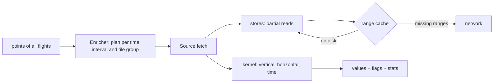

# Architecture

- **Sources** (`GridSource` for ARCO-ERA5, `ArpegeSource`, `OpenMeteoSource`,
  `SourceChain`) implement one contract: a time step, the two cube keys
  bracketing an interval (with a forecast run when relevant), a coverage
  period, and `fetch` returning a regional *cube* (levels × lat × lon).
- **Stores** read bytes: `HttpStore` (range requests, retries, per-host caps,
  redirect learning), `FileStore` for local mirrors, and format readers on
  top (zarr-v2 with Blosc block reads, GRIB2 message index, Open-Meteo `.om`
  tiles).
- **Enricher** groups points by interval, splits each time slice along the
  source's tiling (`Source.tiling`, see `baro.met.tiling`), fetches each
  cube once with bounded look-ahead, and frees it after its last use.
- **Kernel** interpolates a cube at points (see
  [vertical interpolation](vertical.md)).
- **Range cache** (`baro.met.rangecache`) keeps every immutable byte range
  read, below the format readers (`Source.use_cache`): later requests of any
  shape only download the missing ranges.
